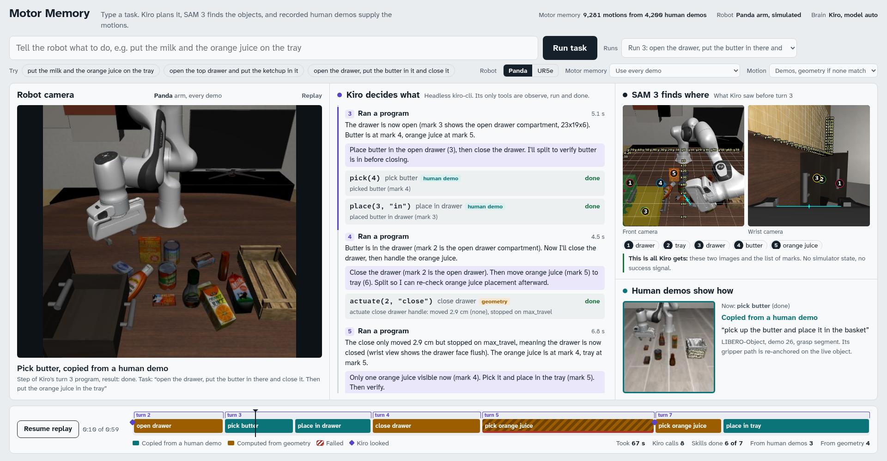

# Motor Memory

A robot harness for tabletop manipulation in simulation (LIBERO / robosuite). Three layers, each doing one job:

- **What:** a frontier model running inside Kiro reads the instruction and the camera images and writes a short program (`pick(3)`, `place(5, "on")`, ...).
- **Where:** SAM 3 masks plus depth give each object a 3-D position and frame.
- **How:** a *motor-memory index* of recorded human demo segments (grasp, place, push, actuate), stored as gripper poses in the frame of the object they act on, is moved onto the live object and executed with operational-space control (OSC).

There's no code generation in the loop, no fine-tuned VLA and no practice on the test tasks. Because segments are stored in the object's frame, one demo per object or interaction serves every layout. The same Panda demos also run on a UR5e, since segments are gripper poses and both arms take the same OSC commands. Adding a demo adds a skill, deleting one removes it, and every motion traces back to a demo id.

Hackachusetts, Robotics & Hardware track. How we used Kiro: [docs/kiro-usage.md](docs/kiro-usage.md). Architecture: [docs/architecture.md](docs/architecture.md).

**Demo video (2 min):** [docs/media/motor_memory.mp4](docs/media/motor_memory.mp4), storyboard in [docs/video-script.md](docs/video-script.md).

Built with Kiro, which is also the robot's brain at run time. After our Kiro credits ran out, the demo video, the live demo page and a couple of late fixes were done with Claude Code ([details](docs/kiro-usage.md#what-we-did-with-claude-code)).

## How it works

```
runner (motormem.brain.runner)  -- per episode: EpisodeSpec json -> ROBOT_EPISODE env var
 └─ kiro-cli chat --no-interactive -a --agent robot-brain --model M "<instruction>"
     robot-brain agent: tools = @robot only; prompt = .kiro/steering/robot-protocol.md
      └─ robot MCP server (motormem.brain.mcp_server, stdio) owns the sim for one episode
           observe(find) / run(program) / done(summary)
            └─ Skills(env, perception, memory, motion_source)       [motormem.skills]
                 ├─ Perception.scan / refine                         [motormem.perception]
                 ├─ MotorMemory.query                                [motormem.memory]
                 └─ RobotEnv.step / observe / kinematics             [motormem.env]
```

## Fairness

Our rules ([.kiro/steering/fairness.md](.kiro/steering/fairness.md)) keep the numbers comparable to published VLA and agent baselines:

> At test time, the brain and skills **never** use simulator object state (`<obj>_pos`, `object-state`, `env.sim` reads, BDDL/init files, asset sizes), simulator segmentation masks, the success signal (except for the runner ending the episode, as in standard LIBERO), or prompts or code written for specific tasks or seeds.
> They **may** use RGB, depth, nominal camera calibration, proprioception, wrist force/torque and the standard training demos. The offline index build may read the demos' recorded sim states to label object poses, as MimicGen does. Ground-truth poses exist only in a runner-only "rung-0" diagnostic mode, which is never reported as a result.
> **Enforcement:** the brain is a Kiro custom agent whose only tools come from the robot MCP server (no shell, files or web). Every observation passes through `strip_privileged()`, and a property test checks that no privileged key ever reaches the agent.

## Live demo: messy desk sorting from a typed prompt

```bash
env -u PYTHONPATH MUJOCO_GL=egl .venv/bin/python scripts/live.py
```
Opens http://localhost:8765: type a task (e.g. "open the top drawer and put the ketchup in it, then put the soup cans and the milk on the tray") and press Run task. Every run starts from a fresh scene; an mp4 is written to `runs/videos/`.



The page has one column for each layer:
- **Robot camera:** the live sim view (~10 fps); once the run ends, a replay at 2x.
- **Kiro decides what:** each Kiro turn shows what it read in the images, its plan, the program it sent, and each step's result.
- **SAM 3 finds where:** the two marked camera images and the list of marks Kiro saw before writing that program. This is everything the brain gets.
- **Human demos show how:** for every motion, the human demo it was copied from (frames cut from the raw LIBERO hdf5, played in step with the replay), or "computed from geometry" when no demo fit.

The timeline colours every skill call by motion source and marks failures; click or drag it to scrub. The options next to the examples switch the arm (Panda / UR5e), make the robot forget one object's demos (editability), or restrict motion to demos only or geometry only (ablation). Everything on the page is read from the files the episode already writes; the page never talks to the sim. `--name <session>` reopens an earlier session under `runs/live/` so its runs replay; `?ep=ep_002&t=120&play=1` links to a moment of a run (useful for recording), and `?theme=dark` forces dark mode.

The scene (`motormem/env/clutter_desk.py`) is a wide desk with twelve everyday items (bottles, cans, cartons, snack boxes) standing at random spots and headings, a wooden tray and a cabinet with three drawers. Nothing is on a grid; the layout is reproducible per seed. The brain sees only camera images with SAM 3 marks; it plans every step in one program, the skills check their own results, and it calls `done` itself.

Scripted checks on this desk (no Kiro): top drawer opened 23 cm, ketchup picked and placed in the drawer, soup can and milk placed on the tray. `--scene grocery_sort` runs the earlier tidier grocery table (`runs/videos/live_test4.mp4`: both ketchup bottles in a basket and both soup cans on the tray from one prompt, 80 s, 6 Kiro calls).

## Results

Our own runs on this laptop: Panda, Kiro as the brain (model `auto`), SAM 3 perception, no simulator state, no success signal to the agent, no practice on the test tasks. Each row is LIBERO-Goal's 10 tasks x 5 initial states = 50 episodes; LIBERO-Pro uses the same tasks with the objects moved (position perturbation) or new instructions (task perturbation).

| | Ours, 300 steps (LIBERO-Pro limit) | Ours, 900 steps | OpenVLA | π0 | π0.5 |
|---|---|---|---|---|---|
| LIBERO-Goal, familiar tasks | 62% (31/50) | 70% (35/50) | 79.2% (98% in the LIBERO-Pro paper) | 95.8% | 98.0% |
| LIBERO-Pro, moved objects | **40%** (20/50) | 50% (25/50) | 0% | 0% | 38% |
| LIBERO-Pro, new instructions | **24%** (12/50) | 26% (13/50) | 0% | 0% | 0% (≈2%) |

What this shows:
- **On familiar tasks, fine-tuned VLAs are ahead.** Our losses sit in specific parts of the harness (drawer handles, box grasps, insertion, missing perception labels; see the diagnostic ladder below). Each is a module that can be improved, or given a demo, without retraining anything.
- **When the scene changes, the VLAs collapse and we hold up.** At the same 300-step limit, OpenVLA and π0 drop to 0% on moved objects and π0.5 to 38%; on new instructions all three are at about 0%. We keep 40% and 24%. Nothing was tuned on these tasks.
- **Cheap:** 3.2 to 4.3 Kiro tool calls per episode on average.

The 300-step column counts the episodes of the same runs that succeeded within their first 300 sim steps (episodes end on success); see [`results/step_limits.md`](results/step_limits.md). VLA numbers are the published ones (the OpenVLA and openpi LIBERO results, and the LIBERO-Pro paper). With 5 episodes per task, treat differences under ~10 points as noise. Per-run tables are in [`results/`](results/).

**Same demos, different robot:** on LIBERO-Goal a UR5e with zero UR5e demos reached 30/50 (60%) in an earlier run before the final fixes ([`results/goal_ur5e`](results/goal_ur5e/summary.md)); wine bottle -> rack 5/5.

**Diagnostic ladder** (scripted programs, no Kiro calls; 3 inits per task; not results, used to find where failures come from): with ground-truth poses vs SAM 3 vs the Kiro brain, the brain beat the script on 9 of 20 task-arm pairs (recovery, choosing push targets), so the remaining losses are in contact skills (drawer handle, box grasp, push distance, bottle placement) and perception (missing labels), which is what the pivot targets. See `docs/architecture.md`.

| other experiments | result | evidence |
|---|---|---|
| Grasp retargeting smoke test (ground-truth poses) | 25/25 lifted with closed-loop tracking vs 0/25 with open-loop replay | `runs/index_report.md` |
| Perception (Grounding DINO + SAM 2.1 fallback, before SAM 3 access) | bowl, plate, bottle, stove 20/20; cream cheese, wine rack, cabinet 0/20 | `runs/perception_check/report.md` |
| SAM 3 noun retry (generic prompt variants) | wine rack 0/3 -> 3/3, cream cheese 0/3 -> 3/3, black bowl 6/9 -> 9/9 frames | `logs/report_percep.md` |
| Editability (desk scene, black book) | demos removed + index-only: `NO_CANDIDATE: no demo of black book in motor memory`; all demos: picked with a STUDY_SCENE3 book demo and placed in the caddy | `runs/videos/editability.jsonl` |
| Live demo, messy desk (free-text tasks) | e.g. open the drawer, put the butter in, close it, put the orange juice in the tray: done in 67 s with 8 Kiro calls, after one missed grasp that Kiro retried | `runs/live/` |

`runs/` and `data/` are git-ignored; they live in the main checkout.

### Prior work and positioning

On LIBERO-Pro, the top scores come from per-task practice that uses the success signal: ASPIRE ([2607.00272](https://arxiv.org/abs/2607.00272)) reaches 98.9% after about $10.8 of practice per task, Harness VLA ([2607.08448](https://arxiv.org/abs/2607.08448)) 92.6% with seed-0 memory and the success signal in its prompt, and ChunkAct ([2610.18874](https://arxiv.org/abs/2610.18874)) 83.8%. Without practice, RACaP ([2609.29394](https://arxiv.org/abs/2609.29394)) reaches 45% and LLM-LIBERO ([2610.30051](https://arxiv.org/abs/2610.30051)) 44% on LIBERO-10. Fine-tuned VLAs score 0–38% under LIBERO-Pro position and task perturbations. We target the no-practice setting. Our action layer is closest to MT3 ([2511.10110](https://arxiv.org/abs/2511.10110)) and MimicGen ([2310.17596](https://arxiv.org/abs/2310.17596)). The observe/run interface borrows from the open Gemini harness from the Goldberg lab ([blog](https://ehehee.github.io/blog/open-gemini-harness)). The articulation skill follows Jain & Kemp (equilibrium point control), Sturm et al. 2011 and Martín-Martín & Brock (online kinematic estimation).

## Setup

```bash
uv venv --python 3.12 .venv
uv pip install --python .venv/bin/python torch==2.11.0 torchvision==0.26.0 --index-url https://download.pytorch.org/whl/cu128
uv pip install --python .venv/bin/python -e ".[dev,mcp]"
env -u PYTHONPATH MUJOCO_GL=egl .venv/bin/python -m pytest -q
```

You also need the LIBERO HDF5 demos under `data/raw/` (see `.kiro/steering/tech.md`), `kiro-cli` on `PATH` for the brain, and Hugging Face access to `facebook/sam3`. Without SAM 3, the code falls back to Grounding DINO + SAM 2.1.

## Run

All commands are prefixed with `env -u PYTHONPATH MUJOCO_GL=egl .venv/bin/python`.

```bash
# 1. Build a motor-memory index from training demos (offline; reads recorded demo states only)
scripts/build_index.py --suites libero_goal --out data/index/libero_goal.pkl --workers 8

# 2. Evaluate with Kiro as the brain: parallel headless kiro-cli sessions, one isolated workspace per episode
-m motormem.brain.runner --suite libero_goal --tasks 0-9 --episodes 10 --arm Panda \
    --model auto --parallel 4 --name goal_panda --motion-source hybrid --perception sam3
#    --arm UR5e for the second arm; --motion-source primitive for the ablation;
#    --backend fake for a sim-free dry run; --scripted is the rung-0 diagnostic (not a result)

# 3. Scene demos (desk sorting, bin sorting), with editability switches and video
scripts/scene_demo.py desk_sort --layout 0 --arm Panda --motion hybrid \
    --exclude-objects black_book --record desk_L0.mp4 --log runs/videos/results.jsonl
```

## Repo map

```
motormem/
  types.py, geometry.py, config.py   shared contracts (SE(3), point clouds, paths)
  env/          LIBERO/robosuite adapters, UR5e mount, strip_privileged, desk/bin scenes
  perception/   SAM 3 / fallback segmenters, deprojection, object estimates, overlays
  memory/       demo replay, segmentation into skills, object-frame index
  skills/       OSC tracking, IK feasibility, pick/place/push/actuate, articulation, primitive fallback
  brain/        program parser, robot MCP server, episode runner
scripts/        build_index, scene_demo, live (demo server + live_page.html), make_video, hooks/
tests/          one file per module; Hypothesis property tests in test_*_props.py
.kiro/          spec, steering, hooks, robot-brain agent, MCP config
docs/           architecture, Kiro usage, Kiro feedback, activity log, video script, media/ (demo video)
video/          Remotion source of the demo video (see video/README.md)
```

## Limitations

- **Pose error.** Placement accuracy depends on perception: a few cm of centroid or ICP error is enough to miss small targets. Some objects (cream cheese, wine rack, cabinet) aren't detected by the fallback segmenter at all.
- **Tight tolerances.** Insertions (e.g. a bottle into a rack slot) need better accuracy than open-loop segment replay on an estimated pose gives. We have no force-guided insertion yet.
- **Unseen shapes need a demo.** Objects with no demo get the hand-written top-down fallback, which is much weaker.
- **Clutter.** Occlusion degrades masks and registration, and segments don't avoid obstacles beyond a lifted approach.
- **Simulation only.** We haven't tested on real hardware.
